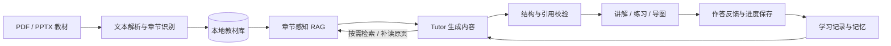

<div align="center">


<h1>Bookside · 书边</h1>

<p><strong>打开课本，就从这一节开始。</strong></p>
<p>A lightweight, textbook-centered learning agent.</p>

<p>
  <a href="#why-bookside">为什么选择书边</a> ·
  <a href="#architecture">技术架构</a> ·
  <a href="#getting-started">开始使用</a> ·
  <a href="#inspiration">Agent 设计与参考</a>
</p>

</div>

---

<a id="why-bookside"></a>

## 让开始学习更容易

准备期末考试时，课本已经在手边，却还要选工具、整理资料、规划路线。功能越多，有时越难开始。

**Bookside 为准备期末的本科生和依赖教材打基础的学生而设计。** 上传课本，选择一节，围绕几个核心问题理解内容，再用练习确认掌握程度。把准备工作的负担交给工具，把注意力留给学习。

**上传教材 → 章节讲解 → 练习反馈 → 导图复习**

| 优势 | 你可以这样学习 |
| :--- | :--- |
| **极简，减少选择负担** | 从当前小节开始，随时追问、跳过练习或回看原文。讲义提问与题目求助各有上下文。 |
| **围绕你的课本** | 支持 PDF / PPTX，通过轻量 RAG 检索教材生成内容，保留原文引用与页码定位。 |
| **复习更有针对性** | 用思维导图串联概念、公式与易混点，选择知识点出题，结合已有作答练习薄弱处。 |
| **适合长时间阅读** | 本地字体、数学公式排版、可调布局；按需展开教材与精选拓展资料。 |
| **进度留在身边** | 本地保存学习记录与可管理的记忆；可选像素桌宠，单击回到学习，右键轻松陪聊。 |

<a id="architecture"></a>

## 技术架构

**章节感知的轻量 RAG，配合工具增强 Tutor。** 教材提供依据，模型按需查阅，应用负责流程与记录。核心服务由一个本地后端承载，无需额外部署向量数据库。

### 技术栈

| 层次 | 技术选型 | 职责 |
| :--- | :--- | :--- |
| 学习工作区 | React · TypeScript · Vite | 章节导航、讲解、练习与进度展示 |
| 阅读与可视化 | PDF.js · KaTeX · React Flow | 教材原页、数学排版与交互式思维导图 |
| 应用与数据 | FastAPI · SQLite | API、异步任务、学习记录与记忆管理 |
| 教材与检索 | PyMuPDF · python-pptx · 本地文本检索 | 文档解析、章节识别、相关片段召回 |
| 模型与检查 | DeepSeek · HTTPX · Pydantic | 模型调用、工具执行、结构校验与内容复查 |
| 可选桌宠 | PySide6 / Qt | 像素动画、网页入口与独立陪聊 |

### 核心技术路线



- **依据可追溯**：按章节范围和词项匹配筛选教材片段，携带页面标识生成内容，支持回到原文核对。
- **工具按需调用**：Tutor 可检索当前学习空间、补读指定原页；历史摘要和偏好为当前任务提供上下文。
- **生成有边界**：结构与引用检查之外，讲解和复习题计划增加模型复查；修复与重试受次数和时间预算约束。

当前检索采用页面评分与重叠文本片段选择，尚未使用 Embedding 或知识图谱。上图展示共用流程，各任务按需使用工具与检查步骤。

<a id="getting-started"></a>

## 开始使用

准备 [Git](https://git-scm.com/downloads)、[uv](https://docs.astral.sh/uv/getting-started/installation/) 和 [Node.js 22.12+](https://nodejs.org/en/download)。Python 3.11+ 环境由 uv 管理。

在本仓库页面点击 **Code → Download ZIP**，解压后进入项目根目录。使用 Git 的开发者也可从 **Code** 菜单复制当前仓库地址进行克隆。

**Windows：** 双击根目录 `BookSide.cmd`，或执行：

```powershell
.\BookSide.cmd
```

脚本会安装依赖、构建网页并启动服务。打开 **[http://127.0.0.1:8765](http://127.0.0.1:8765)**，在设置中配置 DeepSeek，上传教材即可开始。扫描版 PDF 建议先进行 OCR。

- **带桌宠启动**：`.\BookSide.cmd -Desktop`
- **无需密钥体验**：`.\BookSide.cmd -Demo`（固定演示内容）

<details>
<summary><strong>macOS / Linux 与手动启动</strong></summary>

```sh
uv sync --locked
cd frontend
npm ci
npm run build
cd ..
uv run --locked uvicorn backend.app.main:create_app --factory --host 127.0.0.1 --port 8765
```

浏览器访问同一地址。桌宠当前实机验证范围为 Windows。保持终端运行，按 Ctrl+C 停止服务。

</details>

<details>
<summary><strong>开发模式</strong></summary>

安装依赖后，在项目根目录启动后端：

```sh
uv run --locked uvicorn backend.app.main:create_app --factory --host 127.0.0.1 --port 8765 --reload
```

另开终端，在 `frontend` 中执行 `npm run dev`，访问 http://127.0.0.1:5173。贡献前的检查见[贡献指南](docs/CONTRIBUTING.md)。

</details>

> 数据与密钥默认保存在本地 `data/`，已排除 Git 跟踪。在线模型调用会发送相关教材片段与对话，费用按模型服务商规则计算。

<a id="inspiration"></a>

## Agent 设计与参考

Bookside 将教材学习与 Agent 实践结合，保持单个 Tutor 和少量工具的清晰结构。感谢以下项目和公开资料的启发：

| 参考 | Bookside 中的落点 |
| :--- | :--- |
| [DeepTutor](https://github.com/HKUDS/DeepTutor) | 教材驱动的学习流程、工具调用循环与执行边界。 |
| [Claude Code 的记忆设计](https://code.claude.com/docs/en/memory) | 精简上下文、按需使用记忆，支持用户查看与管理。 |
| [Anthropic · Building Effective Agents](https://www.anthropic.com/research/building-effective-agents) | 简单可组合的流程，以及生成后的评估与有限修正。 |

以上为设计参考，Bookside 使用独立实现。模型生成与复查仍可能出错，重要结论可通过引用回到教材核对。

---

[后续计划](docs/ROADMAP.md) · [参与贡献](docs/CONTRIBUTING.md)
