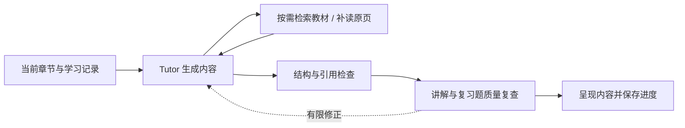

<div align="center">


<h1>书边 · BookSide</h1>

<p><strong>打开课本，就从这一节开始。</strong></p>
<p>A lightweight, textbook-centered learning agent.</p>

<p>
  <a href="#introduction">简介与动机</a> ·
  <a href="#design">设计优势</a> ·
  <a href="#agents">Agent 设计与参考</a> ·
  <a href="#getting-started">开始使用</a>
</p>

<p>课本驱动 &nbsp; / &nbsp; 极简学习 &nbsp; / &nbsp; 本地运行</p>

</div>

---

<a id="introduction"></a>

## 简介与动机

准备期末考试时，我们往往已经有了课本，却迟迟没有开始：要选工具、整理资料、规划路线，还要在许多功能之间来回切换。学习之前的准备，逐渐变成了学习本身的负担。

**BookSide 相信，学习工具应当让“开始”更容易。** 上传教材，选择一个章节，围绕几个核心问题读懂内容，再用练习确认理解。每一步都有明确的下一步，也始终可以按自己的节奏跳过、追问或回到原文。

书边面向**准备期末考试的本科生，以及依赖教材建立基础的低年级学生**。受 DeepTutor 启发，我们把教材驱动的学习 Agent 收进一个轻量工作区，让讲解、练习与复习围绕同一本书展开。

> 一本课本，一节内容，一个开始。把注意力留给学习。

<a id="design"></a>

## 设计优势

### 少一点选择，多一点开始

学习从当前章节展开：先理解核心问题，再决定是否练习。讲义提问与题目求助各有上下文，练习可以自由跳过；需要时展开原文、拓展资料或思维导图，保持主学习区域专注。

| 设计 | 学习时的体验 |
| :--- | :--- |
| **以教材为依据** | 导入 PDF / PPTX，按章节组织内容；讲解关联原文引用，PDF 阅读器支持回到对应位置。 |
| **讲解与练习相连** | 围绕本节核心问题学习，提交答案后获得反馈；针对题目追问时，优先解释题意并给出渐进提示。 |
| **复习有自己的节奏** | 用章节思维导图串联概念、公式与易混点，选择知识点生成复习题，并结合已有作答进行针对性练习。 |
| **阅读舒适，布局可调** | 本地字体、Markdown 与 KaTeX 数学排版；可调整阅读区域和导图视野，支持放大查看。 |
| **教材之外，适量延伸** | 按学科提供人工整理的课程、视频与仓库资源；讲解中的课外补充与教材依据区分呈现。 |
| **进度留在身边** | 教材、学习记录与偏好保存在本地；学习记忆可查看、编辑、删除或关闭。桌面宠物提供可选的网页入口与陪伴。 |

### 一条自然的学习路径

**上传教材 → 选择章节 → 理解与追问 → 练习与反馈 → 导图复习**

平时学习，沿着课本逐节理解；考前复习，从知识关系和薄弱点切入。两种模式共享教材依据，各自保留适合当前任务的交互。

<a id="agents"></a>

## Agent 设计与参考

BookSide 采用**单个 Tutor、少量教材工具与有边界的教学流程**。模型可以按需检索教材、补读原页；应用负责上下文范围、结果校验、调用预算和学习记录的保存。



上图概括讲解和复习题生成流程。不同任务按需使用工具与检查步骤，调用次数和执行时间均设有上限。

### 参考与致谢

感谢以下项目与公开资料提供的设计启发。BookSide 的学习流程采用独立实现，下面列出参考点及其在当前代码中的落点。

| 项目 / 资料 | 参考的设计 | BookSide 中的实现 |
| :--- | :--- | :--- |
| **[DeepTutor](https://github.com/HKUDS/DeepTutor)** · [Agent Loop 源码](https://github.com/HKUDS/DeepTutor/blob/1284116f92368480aef3a47f91b8df9e9b105062/deeptutor/agents/loop/agent_loop.py) | 教材驱动的学习体验、工具调用循环与明确的执行边界。 | Tutor 按需调用教材检索和原页读取工具，围绕当前章节完成任务，并限制每轮调用与重试。 |
| **[Claude Code](https://github.com/anthropics/claude-code)** · [官方记忆设计文档](https://code.claude.com/docs/en/memory) | 精简上下文、按需加载细节，以及用户可管理的持久记忆。 | 以学习偏好、近期记录和压缩摘要组织上下文；记忆存储在 SQLite 中，可编辑、删除和关闭，并隔离课程与陪伴聊天的范围。 |
| **[Anthropic · Building Effective Agents](https://www.anthropic.com/research/building-effective-agents)** | 从简单、可组合的流程开始；通过生成、评估与修正改善结果。 | 讲解与复习题生成后进行独立模型复查；需要修正时在同一预算内重新生成，并结合程序校验检查结构和引用。 |

Claude Code 一项参考其公开文档描述的设计。上述资料是架构参考，使用 BookSide 无需安装这些项目或订阅它们的服务。

<details>
<summary><strong>开发者视角：当前实现的边界与代码入口</strong></summary>

- **工具与结果校验**：[model.py](backend/app/model.py) 管理模型请求、教材工具调用、结构修复和教学内容复查；[pedagogy.py](backend/app/pedagogy.py) 定义不同教学任务的行为。
- **执行预算**：[runtime.py](backend/app/runtime.py) 为单次任务设置模型调用、工具调用和时间上限，避免失控重试。
- **学习记忆**：[memory.py](backend/app/memory.py) 管理偏好、摘要和检索范围。原始记录与摘要分开保存，桌宠聊天隔离于课程工具。
- **轻量技术栈**：React + TypeScript + FastAPI + SQLite。当前教材检索使用本地文本检索，无需额外部署向量数据库。
- **能力边界**：内容复查用于减少错误，仍需结合原文判断；拓展链接来自人工整理的资源目录。图片答案的识别能力取决于所配置模型，识别文本可由用户修订。

</details>

<a id="getting-started"></a>

## 开始使用

### 1. 准备环境并获取源码

安装 [Git](https://git-scm.com/downloads)、[uv](https://docs.astral.sh/uv/getting-started/installation/) 与 [Node.js 22.12+](https://nodejs.org/en/download)。项目使用 Python 3.11+，Python 环境由 uv 管理。

```sh
git clone https://github.com/rob1nseu/LearNest.git BookSide
cd BookSide
```

仓库目前仍使用 `LearNest` 地址，应用名称已更新为 **BookSide**；克隆命令将本地目录命名为 `BookSide`。

### 2. 启动应用

**Windows**：在项目根目录运行：

```powershell
.\BookSide.cmd
```

也可以双击 `BookSide.cmd`，或使用 PowerShell 执行 `.\BookSide.ps1`。启动脚本会按锁文件安装依赖、构建网页并启动服务；首次运行需要联网下载依赖。

启动后访问 **[http://127.0.0.1:8765](http://127.0.0.1:8765)**。保持启动窗口运行，按 `Ctrl+C` 停止服务。

| 可选启动方式 | 用途 |
| :--- | :--- |
| `.\BookSide.cmd -Desktop` | 启动像素桌宠：单击进入学习网页，右键选择“和桌宠聊一聊”。 |
| `.\BookSide.cmd -Demo` | 无需密钥体验界面与流程，使用固定演示内容。 |
| `.\BookSide.ps1 -Check` | 检查启动工具是否可用。 |

<details>
<summary><strong>macOS / Linux，或手动启动</strong></summary>

在项目根目录依次执行：

```sh
uv sync --locked
cd frontend
npm ci
npm run build
cd ..
uv run --locked uvicorn backend.app.main:create_app --factory --host 127.0.0.1 --port 8765
```

同样访问 [http://127.0.0.1:8765](http://127.0.0.1:8765)。构建后的前端由后端统一提供服务。桌面宠物的当前实机验证范围为 Windows，网页应用可按上述方式运行。

</details>

### 3. 开始第一节学习

1. **配置模型**：打开设置，填写自己的 DeepSeek API Key 与模型配置。演示模式可跳过此步。
2. **上传教材**：导入 PDF 或 PPTX，等待解析。建议使用带可提取文本的文件；扫描版 PDF 可先进行 OCR。
3. **选择章节**：开始当前小节的讲解，随时追问或查看教材原页，再按需完成练习。
4. **切换复习**：通过思维导图梳理章节，选择知识点做题，检查尚未掌握的部分。

### 数据与模型服务

陪聊入口位于桌宠右键菜单及系统托盘，聊天记录与原有陪聊记忆自动沿用。勾选“本次不进入长期记忆”可阻止本次内容进入长期记忆与摘要，对话仍保留在本地记录中；记忆可在网页的“记忆 → 仅桌宠陪聊”中管理。普通网页模式专注学习，不显示陪聊浮窗。

教材、数据库与模型配置默认保存在项目的 `data/` 中，已加入 `.gitignore`。API Key 保存在本地配置文件 `model.local.json`，请仅在本机设置中填写。

内部需求稿 `prompt.md`、本地环境文件（含 `.env.example`）和素材生成记录不随公开仓库分发；启动无需这些文件。运行依赖、锁文件、数据库迁移与字体许可证仍保留在仓库中。

**本地运行仍会调用在线模型。** 生成讲解、回答问题或处理答案时，相关教材片段、对话及必要的图片会发送给所配置的模型服务；真实模型调用需要网络，并按供应商规则计费。演示模式使用固定内容。

<details>
<summary><strong>开发模式与常用配置</strong></summary>

安装依赖后，在两个终端中分别启动后端与前端：

```sh
# 终端一：项目根目录
uv run --locked uvicorn backend.app.main:create_app --factory --host 127.0.0.1 --port 8765 --reload
```

```sh
# 终端二：项目根目录
cd frontend
npm run dev
```

开发时访问 [http://127.0.0.1:5173](http://127.0.0.1:5173)，前端会将 API 请求代理到本地后端。

| 环境变量 | 用途 |
| :--- | :--- |
| `BOOKSIDE_DATA_DIR` | 自定义数据存放目录。 |
| `BOOKSIDE_DEMO=1` | 手动启动后端时启用演示模式。 |

提交修改前，可运行：

```sh
uv run ruff check backend scripts desktop
uv run python scripts/check_secrets.py
cd frontend
npm run build
```

项目保留旧环境变量与已有数据库的兼容读取。依赖分别通过 `uv.lock` 和 `frontend/package-lock.json` 固定。

</details>

---

欢迎贡献教材解析案例、学习体验反馈与小范围改进。查看 [后续计划](docs/ROADMAP.md) · [贡献指南](docs/CONTRIBUTING.md)，一起让开始学习更容易。
